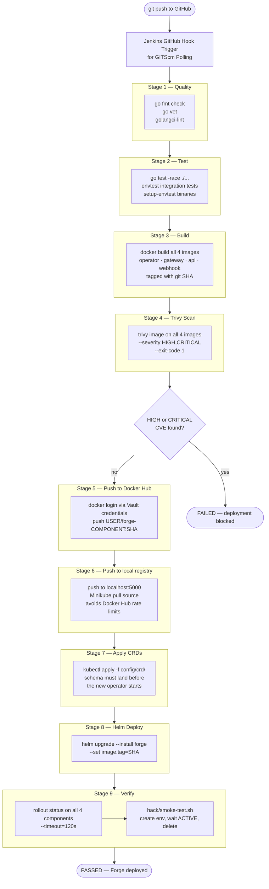

# CI/CD Pipeline



## Why the stage order matters

| Order constraint | Reason |
|---|---|
| Trivy before any push | A vulnerable image must never reach a registry, not even a local one |
| Docker Hub before local registry | The rubric requires Docker Hub; local registry is the pull source for Minikube |
| CRDs before Helm | `helm upgrade` does **not** upgrade CRDs placed in `charts/forge/crds/`. A new operator starting against an old schema fails every reconcile immediately |
| Rollout status before smoke test | Testing against a half-rolled deployment gives a false failure |
| Smoke test last | It is the only stage that proves the deployed system actually works, not just that Pods started |

## Secrets in the pipeline

Docker Hub credentials come from Vault, not from Jenkins credentials store or environment variables in the Jenkinsfile:

```
Jenkins stage → vault read secret/forge/dockerhub → docker login → push
```

Nothing in the repository or the Jenkinsfile contains a credential.
