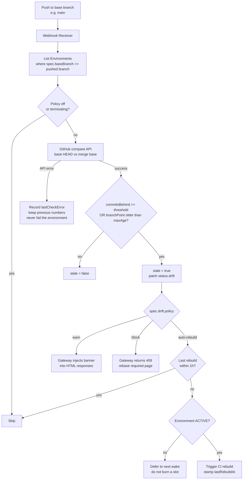
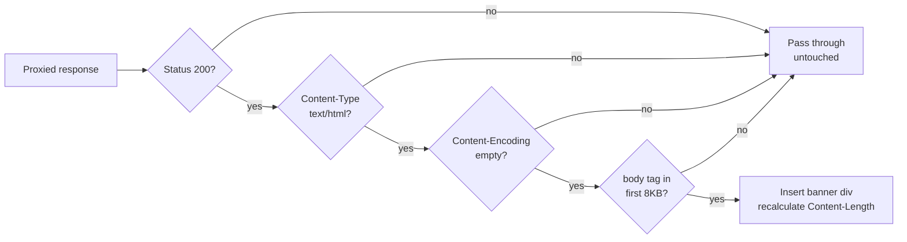

# Environment Drift Detection

A preview environment is built from a PR branch at a point in time. While it lives, the base branch keeps moving. Drift detection measures that gap and acts on it.

## Why each guard exists

| Guard | Without it |
|---|---|
| Filter by `baseBranch` + `baseRepo` | Every push to any branch recomputes drift for every environment |
| Skip terminating environments | Wasted GitHub API calls on environments about to disappear |
| Error never fails the environment | A GitHub outage would break previews that are otherwise fine |
| 1-hour rebuild cooldown | Rebuild → `synchronize` → recheck → still behind → rebuild, an unbounded loop on a busy base branch |
| Skip rebuild when hibernated | Rebuilding something nobody is looking at spends a restoration slot and a build |
| Recompute merge base on `synchronize` | A rebase moves the merge base; comparing against the old one reports drift the developer already fixed |

## Banner injection guards

Rewriting a proxied response body is the most dangerous thing the gateway does. Injection happens only when every condition holds:

A stale `Content-Length` truncates the page in every browser, so it is always recalculated. The banner is a single `div` with inline styles and no script, so a strict Content-Security-Policy on the application cannot break it, and it cannot break the application.

## Two triggers, two failure modes

| Repo type | Commit threshold alone | Age threshold alone | Both |
|---|---|---|---|
| Busy (100 commits/day) | Fires constantly, becomes noise | Never fires meaningfully | Threshold raised per environment |
| Quiet (3 commits/month) | Never fires | Catches a month-old branch point | Correct in both cases |

Either trigger firing marks the environment stale. `commitThreshold: 0` disables the count trigger; an empty `maxAge` disables the age trigger.
