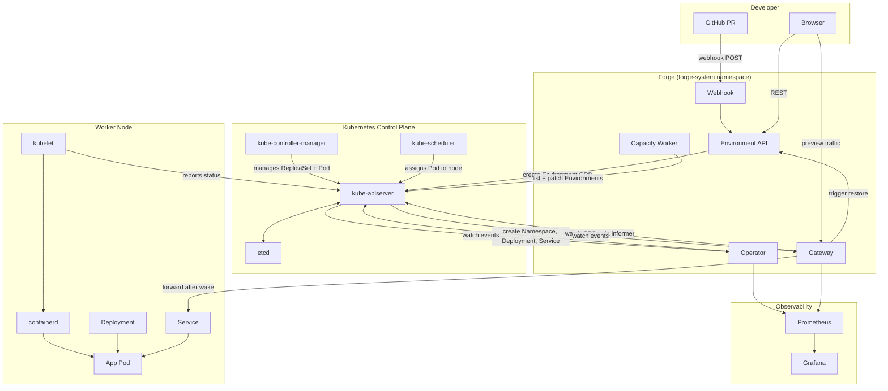

# Forge + Kubernetes Components

| Layer | Components | Owner |
|---|---|---|
| Forge | Operator, Gateway, API, Webhook, Capacity | Your code |
| K8s Control Plane | kube-apiserver, etcd, kube-controller-manager, kube-scheduler | Kubernetes |
| Worker Node | kubelet, containerd, Pods | Kubernetes node |
| Observability | Prometheus, Grafana | Infrastructure |
