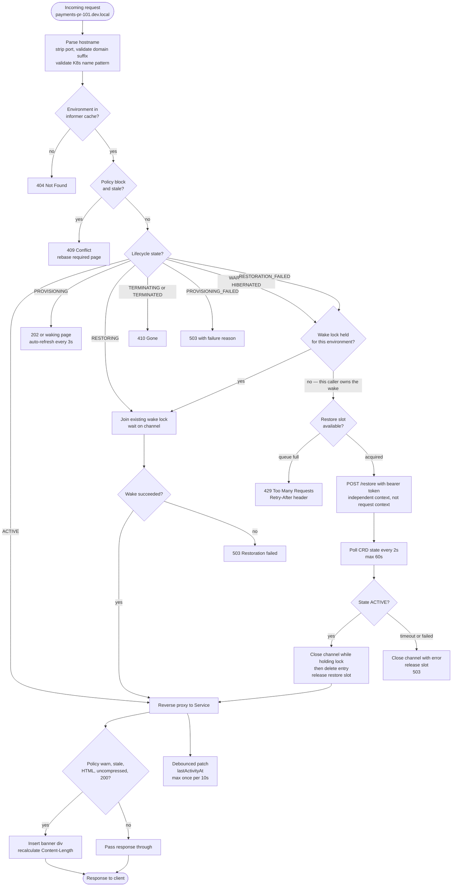

# Gateway Request Flow

## Critical ordering rules

**Deduplicate before acquiring a slot.** If 20 callers arrive at a hibernated environment, the wake lock must dedupe first so exactly one caller reaches the semaphore. Acquiring the slot first means 20 callers consume the entire restore budget and the queue reports itself full against a single environment.

**Close the channel while still holding the lock, then delete the entry.** Deleting first opens a window where a new caller finds no entry, creates its own, and starts a second concurrent restoration of the same environment.

**Use an independent context for the restore, not the request context.** If the restore is tied to the first caller's request context, that caller navigating away cancels a restoration the other 19 are waiting on.

**`RESTORATION_FAILED` enters the wake path, not an error page.** A real request is the signal that a human is waiting, which is exactly when spending a retry attempt is justified. Predictive signals deliberately do not retry failed restorations.

## Status codes

| Code | When |
|---|---|
| 200 | Proxied successfully |
| 202 | Environment provisioning, browser gets the auto-refresh waking page |
| 404 | Hostname does not match any environment |
| 409 | Drift policy is `block` and the environment is stale |
| 410 | Environment is terminating or terminated |
| 429 | Restoration queue full — includes `Retry-After` |
| 503 | Restoration timed out or failed after retries |
