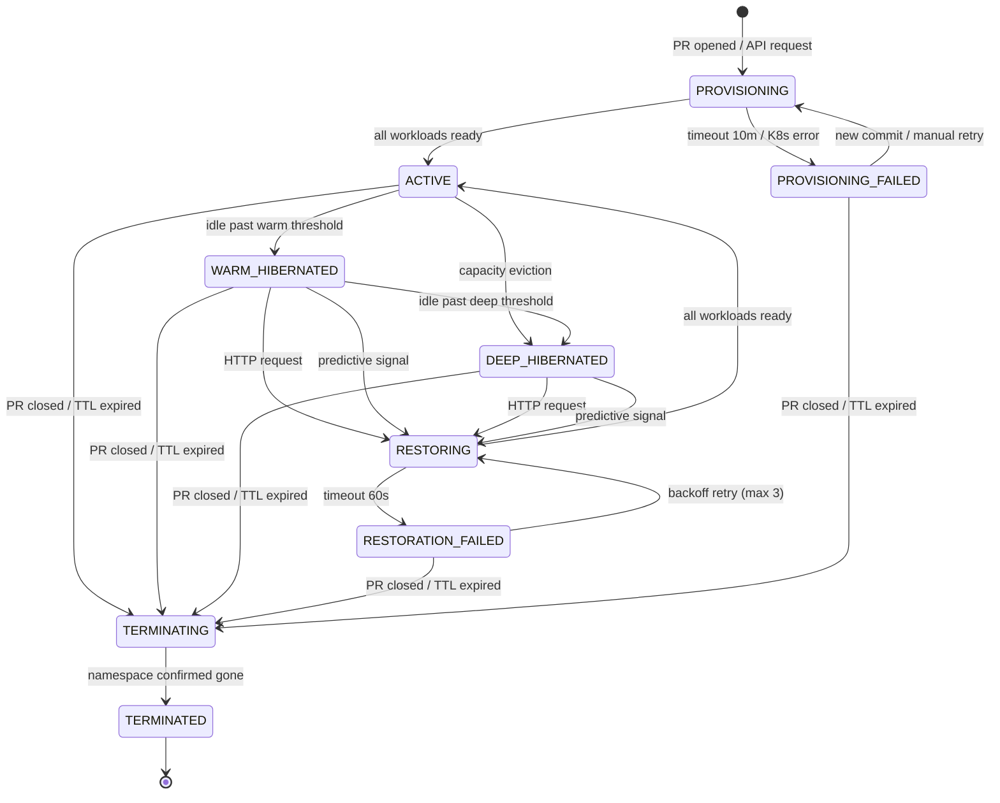
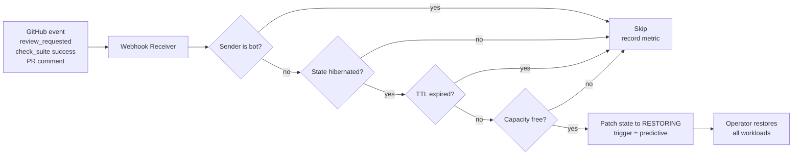

# Environment Lifecycle State Machine

## Predictive wake path

A predictive signal moves a hibernated environment to RESTORING before any request arrives. It is skipped entirely if the environment is not hibernated, is past TTL, has no free capacity slot, or the sender is a bot.

## State reference

| State | What exists | How it exits |
|---|---|---|
| `PROVISIONING` | Namespace, quota, NetworkPolicy being created | → ACTIVE on ready, → PROVISIONING_FAILED on 10m timeout |
| `ACTIVE` | All workloads running, gateway forwarding, inactivity timer ticking | → WARM on idle, → DEEP on eviction, → TERMINATING on close/TTL |
| `WARM_HIBERNATED` | All workloads at replicas 0, Service + Ingress retained, HPAs captured and deleted | → DEEP on deeper idle, → RESTORING on request or signal, → TERMINATING |
| `DEEP_HIBERNATED` | Forge-owned workloads deleted, user workloads at 0, Ingress retained, inventory in CRD status | → RESTORING on request or signal, → TERMINATING |
| `RESTORING` | Workloads being recreated or scaled to `OriginalReplicas`, HPAs restored after | → ACTIVE when all ready, → RESTORATION_FAILED on 60s timeout |
| `RESTORATION_FAILED` | Nothing running; attempt counter held in status | → RESTORING via backoff (30s/60s/120s, max 3), → TERMINATING |
| `PROVISIONING_FAILED` | Namespace may exist; no workloads | → PROVISIONING on new commit, → TERMINATING |
| `TERMINATING` | Namespace deletion in flight; finalizer held | → TERMINATED once namespace confirmed gone |
| `TERMINATED` | Nothing | Terminal — CRD removed |

**Why the Ingress survives deep hibernation:** the gateway routes by hostname. Deleting the Ingress would stop the hostname resolving, so the wake-up request could never reach the gateway and the environment would be unreachable forever. The Ingress points at the gateway Service, not at the app, so it costs nothing while the environment sleeps.
