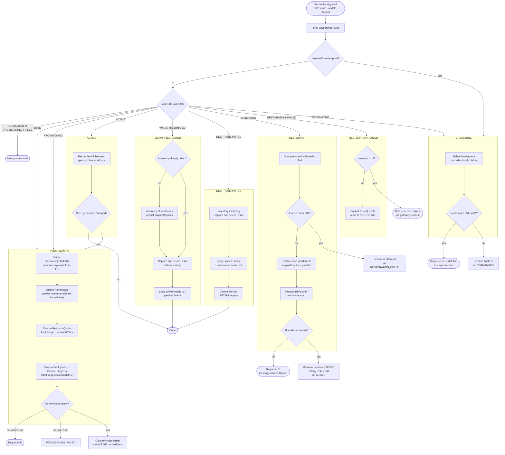

# Operator Reconciliation Loop

## Rules that prevent the known failure modes

| Rule | Failure it prevents |
|---|---|
| Persist `namespaceName` immediately after creating the Namespace | Later provisioner calls read an empty namespace from status and fail |
| Compute `expiresAt` at acceptance, not at readiness | An environment that spends 8h provisioning would then live another 72h |
| Inventory only when `len(hibernatedWorkloads) == 0` | Re-inventorying a half-scaled namespace records `originalReplicas: 0`, so restore brings it back dead |
| Delete HPAs **before** scaling to zero | The HPA controller observes `replicas: 0` and scales straight back to `minReplicas` |
| Restore HPAs **after** workloads exist | A dangling `scaleTargetRef` makes the HPA controller back off |
| Measure restore duration before assigning `restoredAt` | `time.Since(restoredAt)` right after setting it always reads ~0 |
| Use `restorationStartedAt` for the timeout, never `restoredAt` | `restoredAt` is nil during RESTORING, so the timeout check nil-panics |
| Requeue while the Namespace still exists | Removing the finalizer early orphans resources mid-deletion |
| Retain the Ingress through deep hibernation | The hostname stops resolving and the environment can never be woken |
| Terminal states are explicit no-ops | An unhandled state falls through the switch and reconciles forever |
