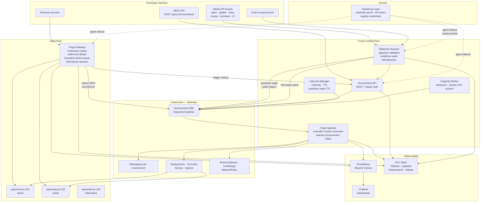

# System Architecture

## Control plane vs data plane

| Plane | Components | What it does | Request path? |
|---|---|---|---|
| Control | Webhook, API, Operator, Lifecycle Manager, Capacity Worker | Decides what should exist and when | No — reacts to events and timers |
| Data | Gateway, application Pods | Carries actual preview traffic | Yes — every reviewer request |

The split matters because the control plane can be slow and eventually consistent without anyone noticing, while the data plane is on the critical path of every page load. This is why the gateway reads CRD state from an in-memory informer cache rather than calling the API server per request.

## Who writes what to the CRD

Three processes patch the same `status` subresource. Each owns a disjoint set of fields, so merge patches do not clobber each other.

| Writer | Fields it owns |
|---|---|
| Operator | `lifecycleState`, `namespaceName`, `previewURL`, `imageDigest`, `hibernatedWorkloads`, `restoredAt`, `restorationStartedAt`, `restorationAttempts`, `conditions` |
| Gateway | `lastActivityAt` only (debounced to at most once per 10s) |
| Lifecycle Manager | `lifecycleState`, `message`, `restorationTrigger` |
| Webhook Receiver | `drift`, and `lifecycleState` only for the hibernated-to-RESTORING predictive transition |

Conflicts on `lifecycleState` are resolved by losing gracefully: a predictive wake that conflicts with a concurrent hibernation is dropped, because the reactive path still covers the reviewer when they actually arrive.
